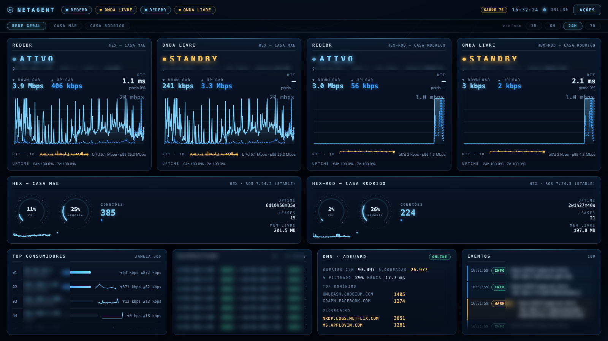
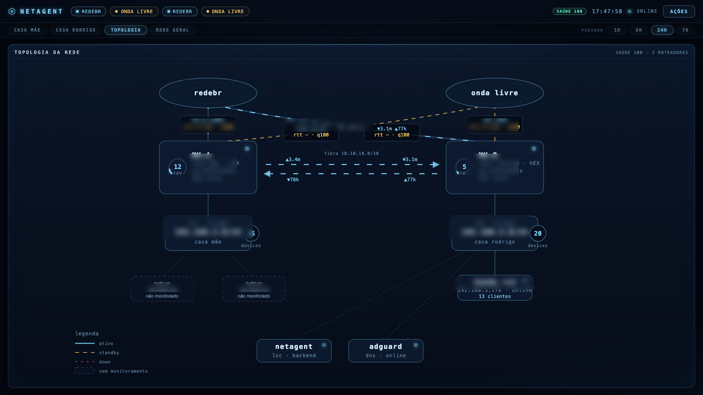
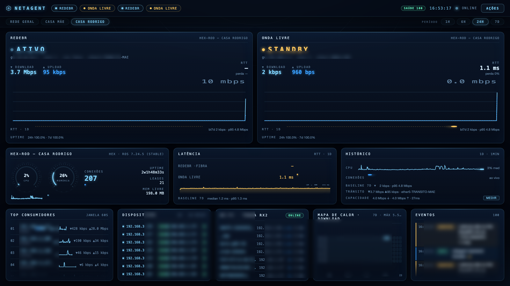

# NetAgent

**AI-assisted home network observability & control** — a real-time monitoring dashboard for a multi-site home network built on MikroTik routers, designed and implemented almost entirely through spec-driven collaboration with an AI coding agent.



---

## Why this exists

Two houses, two failover WAN links each, fiber between them, dozens of devices — and the classic home-lab question: *"what is my network actually doing right now?"*

The goals:

- **See everything live** — link states (active/standby/down), throughput, latency, router health, who's eating bandwidth
- **Know the baseline** — what's normal for my network, so anomalies mean something
- **Act safely** — let automation propose (and eventually execute) bounded actions under supervision
- **Look good doing it** — a JARVIS-style HUD that treats the home network like a spaceship bridge

## What it does

### Dashboard (React + SSE, zero polling on the UI)

- **Per-site pages** — each house gets its own view; a global view shows everything
- **Live link cards** — state, RTT, per-link bandwidth (learned which interface each route actually uses — including traffic tunneled through the inter-site fiber)
- **Health score** (0–100) per link, composed from RTT vs. baseline, loss, and state
- **Heatmap** of bandwidth, 7 days × 24 hours
- **Uptime** per link over 24h / 7d
- **Baselines in SQLite** — rolling 7-day medians/p95 so "unusual" is a number, not a guess
- **Interactive topology map** — live edges animated with real traffic rates, standby links drawn crossing the transit path



### Data plane

- **RouterOS API (TLS)** — polling both routers: interfaces, routes (matched by comment convention), DHCP leases, connection tracking, `/ping` RTT
- **IPFIX collector** — both routers export flows; the backend aggregates per-local-IP rates → top talkers + per-IP history
- **Access Point integration** — the Tenda RX2 web UI was **reverse-engineered from its minified JS bundle**: discovered the real login flow (XHR header contract + session cookie with an RFC-invalid `:` in the name that most HTTP clients silently drop), the `stok`+`sign` handshake, AES-CBC-encrypted responses, and the actual module names (`onlineList`, `systemStatus`)
- **AdGuard Home** — DNS stats: queries, % blocked, top domains
- **Scheduled speedtests** — measured capacity becomes the denominator for saturation %

### Events & alerts

- ntfy for the things that matter (confirmed link down/recovery, router unreachable, sustained critical CPU)
- Everything else lands in the event feed — grouped `×N`, filterable by severity, dismissible
- New-device detection is persistent (a MAC only fires "new" once, surviving restarts)

### Actions (supervised autonomy)

- Allowlisted action templates with bounds: toggle `LINK*` routes, adjust SQM queues within rate limits, force a host through a specific link
- Every action: diff preview → approval → execute → verify → rollback + notification
- Global kill switch for read-only mode



## How it was built (the AI part)

This project is itself an experiment: **can a spec-driven AI agent design, deploy, and iterate a real monitoring stack?** The answer, so far, is yes — with interesting caveats:

- **Spec first** — architecture was written down and approved before any infrastructure was touched (LXC on Proxmox, FastAPI + SQLite + React, RouterOS API-SSL)
- **Subagents for parallel work** — the frontend redesign, alert engine, and topology map were each delegated to independent agent tasks with precise specs
- **Real debugging, not magic** — the hard problems were human-shaped: a `1ms179us` RTT format breaking the parser, an OOM-kill restart loop melting a Docker host, a Tenda login that 302-redirected instead of answering JSON until the correct XHR headers were discovered
- **Reverse engineering as a tool** — the access point's API was recovered by reading its minified JavaScript bundle, not from documentation

## Stack

| Layer | Tech |
|---|---|
| Backend | Python · FastAPI · asyncio · `librouteros` (TLS) · custom IPFIX parser · SQLite (raw samples, 1-min rollups, baselines, per-IP history, devices) |
| Frontend | React · TypeScript · Vite · hand-rolled SVG charts · SSE |
| Infra | Proxmox LXC (Debian) · systemd · MikroTik RouterOS 7 |

## Repo layout

```
backend/app/     FastAPI backend — poller, ipfix, alerts, actions,
                 wifi (Tenda), adguard, db, stream (SSE)
backend/tests/   unit tests
frontend/src/    React SPA — HUD cards, topology map, charts
docs/screenshots/
```

## Privacy note

Sanitized for public release: IPs, credentials, hostnames, and domain names were replaced with placeholders or blurred in screenshots. Deployment-specific values live in `.env` (never committed).

## Status

Working system, deployed and used daily. Agent-driven actions exist behind the allowlist; an LLM advisor module is present but currently disabled (local inference wasn't worth the latency on the available hardware — documented in the code).
